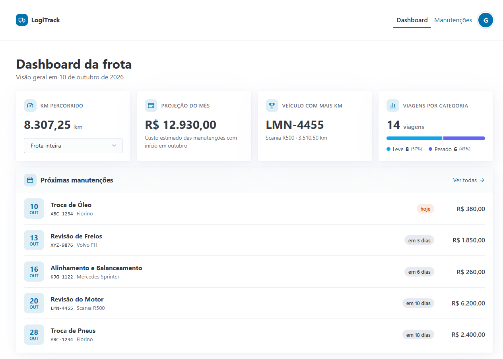
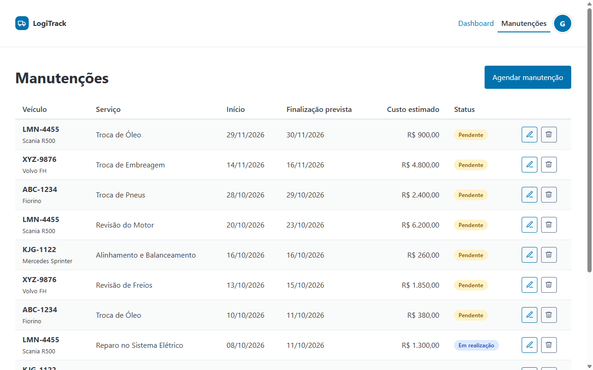
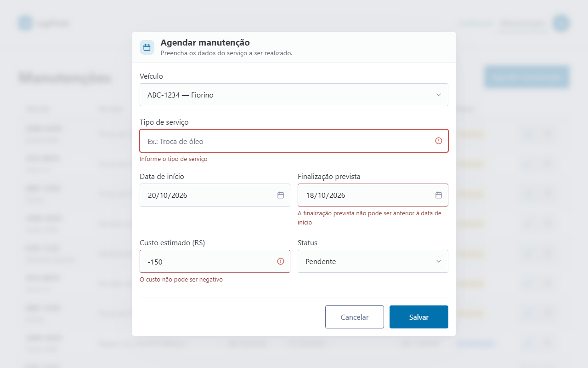
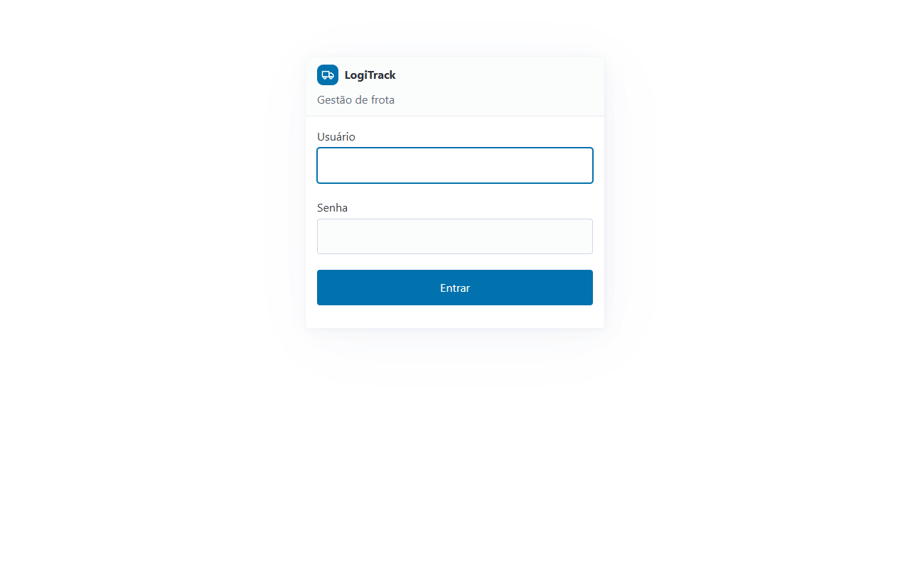

# LogiTrack — gestão de frota

MVP web para uma transportadora fictícia, a LogiTrack, que hoje controla a frota em planilhas. O sistema tem:

- **Agendamento de manutenções**: CRUD completo, com validação e regras de transição de status.
- **Dashboard** com 5 métricas da frota, todas calculadas em SQL no PostgreSQL.
- **Login** com Spring Security.
- **Ambiente completo em Docker**, com um único comando.

**Stack:** Java 21 · Spring Boot 3.5 (Web MVC, Data JPA, JDBC, Validation, Security) · Thymeleaf + Pico.css · PostgreSQL 16 · Flyway · Testcontainers · Docker multi-stage + Docker Compose · Maven Wrapper

---

## Sumário

- [Como rodar](#como-rodar)
- [Telas](#telas)
- [Arquitetura](#arquitetura)
- [Modelo de dados e mudanças no banco](#modelo-de-dados-e-mudanças-no-banco)
- [Métricas do dashboard](#métricas-do-dashboard)
- [Regras de negócio das manutenções](#regras-de-negócio-das-manutenções)
- [Decisões técnicas](#decisões-técnicas)
- [Testes](#testes)

---

## Como rodar

### Pré-requisito

- [Docker](https://docs.docker.com/get-docker/) com Docker Compose (Docker Desktop no Windows e no macOS).

Não é preciso ter Java nem Maven instalados: a aplicação é compilada dentro do container.

### Subir

```bash
git clone https://github.com/BigLeno/logitrack-spring.git
cd logitrack-spring
docker compose up --build
```

Acesse **http://localhost:8080** e entre com:

| Usuário | Senha |
|---|---|
| `gestor` | `logitrack123` |

Na primeira subida, o Compose faz tudo na ordem:

1. Sobe o PostgreSQL e espera o healthcheck.
2. Compila a aplicação.
3. Inicia a aplicação. Ao iniciar, o Flyway cria o schema e carrega os dados de exemplo.

### Dados de exemplo

A carga de exemplo usa datas **relativas ao dia em que o banco foi criado** (por exemplo, `CURRENT_DATE + 3`), para o cronograma e a projeção do mês nunca ficarem vazios. Para recriar o banco com datas atualizadas:

```bash
docker compose down -v   # apaga o volume do banco
docker compose up --build
```

### Configuração

Todas as variáveis têm valor padrão. O `docker-compose.yml` já define as necessárias.

| Variável | Padrão | Uso |
|---|---|---|
| `DB_URL` | `jdbc:postgresql://localhost:5432/logitrack` | URL JDBC do PostgreSQL |
| `DB_USER` / `DB_PASSWORD` | `logitrack` / `logitrack` | Credenciais do banco |
| `APP_USUARIO` / `APP_SENHA` | `gestor` / `logitrack123` | Usuário de acesso ao sistema |
| `TZ` | `America/Sao_Paulo` (no Compose) | Fuso da JVM; define o "hoje" das métricas ([por quê](#fuso-horário-fixo)) |

### Rodar fora do Docker (desenvolvimento)

```bash
docker compose up -d db      # só o banco
./mvnw spring-boot:run       # Windows: .\mvnw.cmd spring-boot:run
```

---

## Telas

### Dashboard


### Manutenções


### Formulário (modal) com erros de validação


### Login


---

## Arquitetura

Aplicação monolítica em camadas, com páginas renderizadas no servidor:

```
Navegador
   │  HTTP (HTML + formulários)
   ▼
Spring Security ── filtros: sessão autenticada? token CSRF válido?
   ▼
Controller ─────── só HTTP: recebe o formulário, dispara a validação, escolhe a view
   │  DTOs
   ▼
Service ────────── regras de negócio e transações (@Transactional)
   │  entidades / DTOs
   ▼
Repository ─────── acesso a dados
   ├─ Spring Data JPA (CRUD de manutenções)
   └─ JdbcTemplate + SQL puro (métricas do dashboard)
   ▼
PostgreSQL ─────── schema versionado pelo Flyway
```

### Organização do código

```
src/main/java/com/logitrack
├── config/        SecurityConfig: regras de acesso, login e usuário em memória
├── controller/    DashboardController, ManutencaoController, LoginController, HomeController
├── service/       DashboardService, ManutencaoService, VeiculoService
├── repository/    ManutencaoRepository, VeiculoRepository (JPA), DashboardRepository (JDBC)
├── domain/        Manutencao, Veiculo (entidades), StatusManutencao, TipoVeiculo (enums)
├── dto/           ManutencaoForm (entrada), ManutencaoResumo, VeiculoOpcao (saída)
│   └── dashboard/ DashboardDados, VolumeCategoria, ProximaManutencao, VeiculoKm
└── exception/     RegraNegocioException, RecursoNaoEncontradoException

src/main/resources
├── db/migration/  V1__schema_inicial.sql, V2__constraints_indices_e_carga_atual.sql
├── templates/     páginas Thymeleaf (dashboard, manutencoes/, login, fragments/, error/)
└── static/css/    estilos próprios sobre o Pico.css
```

### Responsabilidade de cada camada

- **Controllers** não contêm regra de negócio nem acessam repositories. Recebem e devolvem DTOs.
- **Services** concentram as regras e definem os limites de transação. São a única camada que manipula entidades JPA.
- **DTOs** separam a tela do modelo de dados. Isso evita *mass assignment* (o form só tem os campos que o usuário pode enviar) e erros de *lazy loading* fora da transação, porque `spring.jpa.open-in-view=false`.
- **Repositories**: JPA para o CRUD e SQL puro para os relatórios (veja [Decisões técnicas](#decisões-técnicas)).

### Rotas

| Método | Rota | Descrição |
|---|---|---|
| GET | `/login` | Tela de login (pública) |
| GET | `/dashboard?veiculoId=` | Dashboard; `veiculoId` opcional filtra o total de KM |
| GET | `/manutencoes` | Lista de manutenções |
| GET | `/manutencoes/nova` | Formulário de agendamento |
| POST | `/manutencoes` | Cria |
| GET | `/manutencoes/{id}/editar` | Formulário de edição |
| POST | `/manutencoes/{id}` | Atualiza |
| POST | `/manutencoes/{id}/excluir` | Exclui |
| POST | `/logout` | Encerra a sessão |

---

## Modelo de dados e mudanças no banco

```
veiculos (id, placa UNIQUE, modelo, tipo LEVE|PESADO, ano)
   ├──< viagens     (id, veiculo_id, data_saida, data_chegada, origem, destino, km_percorrida)
   └──< manutencoes (id, veiculo_id, data_inicio, data_finalizacao, tipo_servico, custo_estimado, status)
```

O schema é versionado pelo Flyway em duas migrations:

- **[V1__schema_inicial.sql](src/main/resources/db/migration/V1__schema_inicial.sql)**: o schema original do sistema, sem alterações, com os dados iniciais.
- **[V2__constraints_indices_e_carga_atual.sql](src/main/resources/db/migration/V2__constraints_indices_e_carga_atual.sql)**: as melhorias abaixo. Elas ficam numa migration separada para o ponto de partida continuar intacto e cada mudança continuar rastreável.

### O que a V2 altera e por quê

**1. Constraints de integridade.** O banco é a última barreira contra dados inválidos, inclusive os que não passam pela aplicação, como um script ou acesso direto pelo psql.

| Constraint | Motivo |
|---|---|
| `CHECK (status IN ('PENDENTE','EM_REALIZACAO','CONCLUIDA'))` | No schema original os valores válidos estavam só num comentário. |
| `veiculos.tipo NOT NULL` | O `CHECK (tipo IN (...))` aceita `NULL`, e um veículo sem tipo sumiria da métrica por categoria. |
| `CHECK (data_chegada >= data_saida)` (viagens) | Evita viagens com duração negativa. Chegada nula continua permitida (viagem em andamento). |
| `CHECK (data_finalizacao >= data_inicio)` (manutenções) | Mesmo motivo; finalização nula continua permitida. |
| `CHECK (km_percorrida >= 0)` e `CHECK (custo_estimado >= 0)` | Valores negativos distorceriam somas e rankings. |
| `veiculo_id NOT NULL` (viagens e manutenções); `status NOT NULL` | Viagem ou manutenção sem veículo não faz sentido, e sumiria das métricas por veículo. |

**2. `ON DELETE CASCADE` → `ON DELETE RESTRICT` nas duas chaves estrangeiras.** Com CASCADE, excluir um veículo apagaria todo o seu histórico de viagens e manutenções, e o KM total da frota e o ranking mudariam retroativamente. Histórico operacional não pode desaparecer por efeito colateral. Com RESTRICT, o banco recusa a exclusão enquanto houver registros ligados ao veículo. Se for preciso tirar um veículo de circulação, o caminho é marcá-lo como inativo, não apagá-lo.

**3. Índices.** O PostgreSQL cria índices automaticamente para `PRIMARY KEY` e `UNIQUE`, mas **não para chaves estrangeiras**.

| Índice | Usado por |
|---|---|
| `idx_viagens_veiculo_id` | KM por veículo, ranking, JOIN da métrica por categoria e checagem do RESTRICT |
| `idx_manutencoes_veiculo_id` | JOIN com veículos e checagem do RESTRICT |
| `idx_manutencoes_data_inicio` | Cronograma (filtro e `ORDER BY` na mesma coluna) e projeção do mês (intervalo de datas) |

**4. Dados de exemplo com datas atuais.** Os dados originais são de 2024, então "próximas manutenções" e "custo do mês atual" ficariam sempre vazios. A V2 insere 11 viagens (para os 4 veículos) e 9 manutenções com datas relativas a `CURRENT_DATE`:

- 7 pendentes e futuras, algumas dentro do mês atual;
- 1 concluída no dia 1º do mês;
- 1 em realização.

Os veículos são localizados pela placa, não por id fixo.

---

## Métricas do dashboard

As cinco métricas são consultas SQL executadas no PostgreSQL ([DashboardRepository](src/main/java/com/logitrack/repository/DashboardRepository.java)). O banco devolve só o resultado agregado. As cinco rodam numa mesma transação somente leitura em `REPEATABLE READ`, então enxergam o mesmo snapshot e os números são coerentes entre si.

### 1. Total de KM percorrido

Soma da quilometragem da frota inteira ou, com o filtro da tela, de um veículo. `COALESCE` devolve `0` quando não há viagens.

```sql
SELECT COALESCE(SUM(km_percorrida), 0) FROM viagens;                       -- frota
SELECT COALESCE(SUM(km_percorrida), 0) FROM viagens WHERE veiculo_id = ?;  -- veículo
```

São duas consultas, e o service escolhe qual chamar. O padrão `WHERE (? IS NULL OR veiculo_id = ?)` foi evitado porque gera um plano único que nem sempre usa o índice.

### 2. Volume por categoria

Quantidade de viagens por tipo de veículo (LEVE × PESADO). A consulta parte da lista fixa de categorias com `LEFT JOIN`, para que **uma categoria sem viagens apareça com 0** em vez de sumir. `COUNT(vg.id)` não conta a linha vazia gerada pelo LEFT JOIN.

```sql
SELECT t.tipo, COUNT(vg.id) AS total_viagens
FROM (VALUES ('LEVE'), ('PESADO')) AS t (tipo)
LEFT JOIN veiculos v ON v.tipo = t.tipo
LEFT JOIN viagens vg ON vg.veiculo_id = v.id
GROUP BY t.tipo
ORDER BY t.tipo;
```

### 3. Cronograma: próximas 5 manutenções

"Agendada" foi interpretado como **status `PENDENTE` com data de início a partir de hoje**. Manutenções em realização ou concluídas já começaram e não entram. A ordenação é por data de início, com o id como desempate estável.

```sql
SELECT m.id, v.placa, v.modelo, m.data_inicio, m.data_finalizacao, m.tipo_servico, m.custo_estimado,
       m.data_inicio - CURRENT_DATE AS dias_ate   -- exibido como "hoje", "amanhã", "em N dias"
FROM manutencoes m
JOIN veiculos v ON v.id = m.veiculo_id
WHERE m.status = 'PENDENTE'
  AND m.data_inicio >= CURRENT_DATE
ORDER BY m.data_inicio, m.id
LIMIT 5;
```

### 4. Ranking de utilização

Veículo com a **maior soma** de quilometragem. Em caso de empate, vence a placa em ordem alfabética, para o resultado ser determinístico. As viagens são agregadas por veículo **antes** do JOIN, então o JOIN é feito com uma linha por veículo, não com cada viagem.

```sql
SELECT v.id, v.placa, v.modelo, t.km_total
FROM (
    SELECT veiculo_id, SUM(km_percorrida) AS km_total
    FROM viagens
    GROUP BY veiculo_id
) t
JOIN veiculos v ON v.id = t.veiculo_id
ORDER BY t.km_total DESC, v.placa
LIMIT 1;
```

### 5. Projeção financeira do mês

Soma do custo estimado de **todas as manutenções que começam no mês atual, em qualquer status**: é o custo previsto do mês, inclusive o que já foi executado. O filtro compara a coluna com um **intervalo de datas** (`>=` primeiro dia do mês e `<` primeiro dia do mês seguinte), em vez de aplicar uma função sobre a coluna (como `EXTRACT(MONTH FROM data_inicio)`). Assim o PostgreSQL usa o índice em `data_inicio`, e o limite exclusivo funciona para meses de qualquer tamanho.

```sql
SELECT COALESCE(SUM(custo_estimado), 0)
FROM manutencoes
WHERE data_inicio >= date_trunc('month', CURRENT_DATE)::date
  AND data_inicio <  (date_trunc('month', CURRENT_DATE) + INTERVAL '1 month')::date;
```

---

## Regras de negócio das manutenções

- **Validação (Bean Validation, no `ManutencaoForm`):**
  - veículo, data de início, tipo de serviço (até 100 caracteres), custo estimado e status são obrigatórios;
  - o custo deve ser ≥ 0, com até 2 casas decimais;
  - a finalização prevista não pode ser anterior ao início.

  Os erros aparecem **no próprio formulário**, ao lado de cada campo.
- **Status** é um enum Java (`StatusManutencao`) gravado como texto. Transições permitidas:

  ```
  PENDENTE ──► EM_REALIZACAO ──► CONCLUIDA
      └──────────────────────────────▲
  ```

  Nada sai de `CONCLUIDA`, e também não é possível voltar para `PENDENTE`. A tela de edição só oferece os status alcançáveis a partir do atual. Mesmo assim, o `ManutencaoService` valida a transição no servidor, porque o HTML pode ser manipulado. Uma transição proibida aparece como erro no campo de status.
- **Na criação**, qualquer status é aceito, para permitir registrar uma manutenção que já aconteceu.

---

## Decisões técnicas

### Spring Data JPA no CRUD, JdbcTemplate e SQL puro no dashboard
Cada ferramenta onde ela é mais forte:
- **CRUD:** opera uma entidade por vez, e o JPA elimina o SQL repetitivo de INSERT e UPDATE.
- **Dashboard:** é relatório (agregações, `LEFT JOIN` com lista de categorias, `date_trunc`, `LIMIT`).
  - Com SQL puro, cada consulta é exatamente a que foi analisada com `EXPLAIN`, sem uma tradução JPQL no meio.
  - O banco devolve só o número final, em vez de a aplicação carregar entidades para somar em memória.
  - O `DashboardRepository` separado deixa explícito que as métricas vêm do SQL.

### Flyway para o schema
O schema é código: versionado, revisável e aplicado igual em todo ambiente, inclusive nos testes. O Hibernate roda com `ddl-auto=validate`: não altera o banco, só confere na inicialização se as entidades batem com as tabelas, e a aplicação nem sobe se houver divergência.

### ON DELETE RESTRICT e índices nas chaves estrangeiras
Veja [O que a V2 altera e por quê](#o-que-a-v2-altera-e-por-quê). Em resumo, histórico não se apaga em cascata, e chave estrangeira sem índice vira varredura completa em todo JOIN.

### Thymeleaf em vez de um SPA (React)
O escopo é um MVP com um CRUD e um painel. Páginas renderizadas no servidor permitem:
- uma única aplicação, um único deploy e um único container;
- validação exibida no formulário sem uma API intermediária;
- CSRF e sessão resolvidos pelo Spring Security sem configuração extra.

Um SPA dobraria a infraestrutura (build de front, API REST, CORS, autenticação por token) sem ganho para o usuário neste estágio. Onde a interatividade ajuda (formulário em modal, confirmação de exclusão, indicadores de carregamento), um JavaScript pequeno e sem framework reaproveita o HTML que o próprio servidor renderiza. As camadas de service e DTO já isolam a regra de negócio, então expor uma API REST no futuro é acrescentar controllers, não reescrever.

### Spring Security com usuário em memória
Login por formulário, senha com hash BCrypt e CSRF ligado. Toda rota exige autenticação, exceto `/login`, os arquivos estáticos (`/css/**`, `/js/**`, favicon) e `/error`, então uma rota nova já nasce protegida. Logout e exclusões são POST com token. Para ter vários usuários, basta trocar o bean `UserDetailsService` por uma implementação que leia de uma tabela.

### Fuso horário fixo
As métricas usam `CURRENT_DATE`, calculado no fuso da sessão do PostgreSQL. O driver JDBC define esse fuso a partir do fuso da JVM, e uma JVM em container roda em UTC por padrão. Sem ajuste, depois das 21h (horário de Brasília) o dashboard consideraria o dia seguinte. Por isso:
- o container da aplicação define `TZ=America/Sao_Paulo`;
- o PostgreSQL sobe com `timezone=America/Sao_Paulo`, para consultas feitas direto no banco enxergarem o mesmo dia.

### Docker multi-stage
- **Estágio de build:** JDK + Maven Wrapper. O `pom.xml` é copiado antes do código, então as dependências ficam em cache entre builds.
- **Imagem final:** só o JRE e o `.jar`, rodando com um usuário sem privilégios.
- **`.dockerignore`:** é uma lista do que entra no build (`mvnw`, `.mvn`, `pom.xml`, `src`).

### Outros detalhes
- **N+1 evitado:** a listagem de manutenções usa `@EntityGraph` para trazer o veículo no mesmo SELECT.
- **Post/Redirect/Get:** depois de salvar, um F5 não reenvia o formulário.
- **Modais com melhoria progressiva** ([app.js](src/main/resources/static/js/app.js)):
  - O formulário de manutenção abre num modal: o JavaScript busca a mesma página renderizada pelo servidor e envia o formulário por `fetch`.
  - Erros de validação voltam do servidor e aparecem no próprio modal; com sucesso, a resposta é o redirect de sempre.
  - A exclusão pede confirmação num modal que mostra qual manutenção será apagada.
  - Sem JavaScript, tudo funciona por páginas e formulários normais, e a validação continua 100% no servidor.
- **Feedback de carregamento:** barra de progresso no topo durante a navegação, e spinner com o botão desabilitado durante o envio (evita envio duplo).
- **Tema claro e escuro:** segue a preferência do sistema operacional.
- **Arquivos estáticos versionados por hash de conteúdo** (`app-<hash>.css`): o navegador nunca usa um CSS antigo do cache.
- **`.gitattributes`:** força LF em `mvnw` e `Dockerfile`, para o build no container funcionar a partir de um checkout no Windows.

---

## Testes

**Testes de integração** das cinco consultas do dashboard ([DashboardRepositoryTest](src/test/java/com/logitrack/repository/DashboardRepositoryTest.java)), contra um **PostgreSQL real via Testcontainers**:

- **Banco igual ao de produção:** a imagem é a mesma do Compose, e o schema é criado pelas mesmas migrations do Flyway. Um banco em memória como o H2 não executaria `date_trunc`, `VALUES` como tabela nem `INTERVAL` da mesma forma.
- **Isolamento:** cada teste roda numa transação desfeita ao final, limpa a carga de exemplo e insere só os dados do cenário.
- **Datas:** são calculadas a partir do `CURRENT_DATE` do banco, então o resultado não depende do dia da execução.
- **Casos de borda:**
  - soma sem linhas (`0`, não `null`);
  - categoria sem viagens;
  - desempate do ranking;
  - limites do mês na projeção (dia 1º e último dia entram; véspera e mês seguinte ficam de fora);
  - manutenção de hoje (entra) e de ontem (não entra) no cronograma.

```bash
./mvnw test     # requer Docker em execução
```
